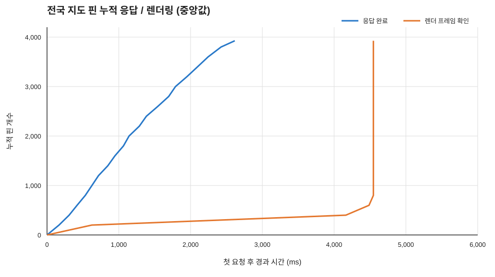

# 전국 지도 핀 응답 및 렌더링 측정 — 2026-10-12

한국 전역 bounds로 개발 서버의 개별 핀 목록을 요청하고, 200개씩 도착할 때마다 요청·응답 및 누적 핀의 native 지도 프레임 표시 시각을 측정했다. Galaxy S23 FE, Android 15, Wi-Fi에서 준비 실행 3회 후 30회 반복했으며 **30회 모두 전체 3,926개 핀 렌더 확인까지 성공**했다.

## 실험 조건

- API: `https://api-dev.pheeeew.com/api/v1/emotions/map`, bounds `124..132°E, 33..39°N`
- 카메라: 중심 위도 36.0°, 경도 128.0°, zoom 5.0. 측정 화면 viewport가 요청 범위 전체를 포함했다.
- 각 반복은 커서 페이지를 순서대로 조회했다. 20페이지 중 앞 19페이지는 200개, 마지막 페이지는 126개였다.
- 제품의 전국 줌아웃 화면은 지역 집계 클러스터를 사용하므로, 측정 화면에서는 개별 핀 3,926개를 native pin layer에 직접 넣었다.
- 페이지 응답 시간은 HTTP 요청 시작부터 본문 전체 수신까지다. 응답→렌더 시간은 해당 페이지까지의 누적 고유 핀 ID가 `queryRenderedFeatures` 결과에 잡힌 첫 native 완료 프레임까지다. 전체 시간은 첫 요청 시작부터 누적 핀의 해당 프레임까지다.
- P50은 중앙값, P95는 30회 nearest-rank(`ceil(0.95 × n)`)다. 페이지 요청과 렌더링이 겹치는 순차 로딩 흐름을 그대로 측정했다.

## 전체 시간

단위는 ms이며, 반복별 시간 분포의 중앙값 / P95다.

| 구간 | 중앙값 / P95 | 최소–최대 |
|---|---:|---:|
| 첫 요청 → 마지막 응답 완료 | 2616 / 3189 | 2116–3306 |
| 마지막 응답 → 전체 핀 렌더 확인 | 1906 / 2312 | 1456–2410 |
| 첫 요청 → 전체 핀 렌더 확인 | **4547 / 5129** | 3836–5382 |

전체 600회 페이지 요청의 응답 시간은 중앙값 81ms, P95 256ms였다. 마지막 126개 페이지는 중앙값 63ms, P95 655ms였다.

## 누적 핀 개수별 시간

각 셀은 중앙값 / P95(ms)다. `첫 요청→응답 완료`는 해당 누적 개수까지 응답이 도착한 시각이고, `첫 요청→누적 렌더`는 그 핀 ID들이 native 렌더 프레임에서 모두 확인될 때까지의 전체 시간이다.

| 누적 핀 수 | 페이지 요청→응답 | 첫 요청→응답 완료 | 응답→누적 렌더 | 첫 요청→누적 렌더 |
|---:|---:|---:|---:|---:|
| 200 (200 수신) | 167/255 | 167/255 | 464/4934 | 624/5096 |
| 400 (200 수신) | 117/172 | 308/402 | 3798/4801 | 4163/5096 |
| 600 (200 수신) | 102/211 | 419/594 | 4045/4733 | 4486/5129 |
| 800 (200 수신) | 96/188 | 533/764 | 4017/4596 | 4547/5129 |
| 1,000 (200 수신) | 70/109 | 626/847 | 3933/4524 | 4547/5129 |
| 1,200 (200 수신) | 79/127 | 717/969 | 3825/4383 | 4547/5129 |
| 1,400 (200 수신) | 87/161 | 847/1060 | 3710/4294 | 4547/5129 |
| 1,600 (200 수신) | 67/119 | 946/1129 | 3640/4172 | 4547/5129 |
| 1,800 (200 수신) | 79/152 | 1065/1237 | 3529/4004 | 4547/5129 |
| 2,000 (200 수신) | 77/168 | 1143/1456 | 3452/3907 | 4547/5129 |
| 2,200 (200 수신) | 74/188 | 1286/1546 | 3285/3791 | 4547/5129 |
| 2,400 (200 수신) | 75/243 | 1384/1706 | 3148/3720 | 4547/5129 |
| 2,600 (200 수신) | 68/294 | 1544/1815 | 2987/3601 | 4547/5129 |
| 2,800 (200 수신) | 60/288 | 1695/1911 | 2879/3411 | 4547/5129 |
| 3,000 (200 수신) | 81/325 | 1790/2096 | 2759/3268 | 4547/5129 |
| 3,200 (200 수신) | 75/282 | 1949/2222 | 2620/3087 | 4547/5129 |
| 3,400 (200 수신) | 80/341 | 2097/2413 | 2500/3013 | 4547/5129 |
| 3,600 (200 수신) | 71/290 | 2244/2582 | 2299/2845 | 4547/5129 |
| 3,800 (200 수신) | 78/519 | 2425/2710 | 2170/2672 | 4547/5129 |
| 3,926 (126 수신) | 63/655 | 2616/3189 | 1906/2312 | 4547/5129 |

응답은 중앙값 기준 2.62초에 3,926개까지 도착했지만 전체 핀의 렌더 확인까지는 4.55초가 걸렸다. 마지막 응답 이후 렌더 완료까지 중앙값 1.91초가 더 필요했다. 800개 이후 각 누적 렌더 완료 중앙값은 4.55초로 같아, 페이지 응답마다 렌더 결과가 바로 늘어나기보다 여러 페이지 데이터가 뒤늦게 함께 확인되는 양상이었다.

## 핀 개수 불일치

별도의 v2 지역 요약 요청은 같은 bounds에서 14:42 KST에 9개 시도 합계 **3,466개**를 반환했다. 이번 v1 개별 핀 페이지 조회는 14:55–14:58 KST 전 구간에서 **3,926개**를 반환했고 30회 모두 같은 수였다. 두 API 결과는 460개 차이가 있어, 렌더링 측정은 실제 개별 핀 레이어를 구성한 v1 응답 3,926개 기준으로 했다. 두 API 집계 차이는 별도 확인이 필요하다.

결과는 한국 bounds 안의 개발 서버 개별 핀 목록과 해당 기기·네트워크·지도 빌드에 한정된다. 렌더 확인은 native 지도 질의로 판정했으며 순수 GPU 시간은 아니다.

## 파일

[원시 이벤트](measurements.jsonl) · [페이지별 원본](pages.csv) · [페이지별 P50/P95](batch-summary.csv) · [회차별 요약](runs.csv) · [시간별 누적 개수](count-over-time.csv) · [환경](environment.json) · [요약 JSON](summary.json)
