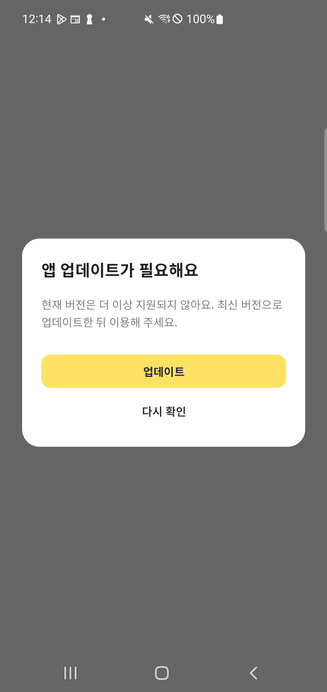
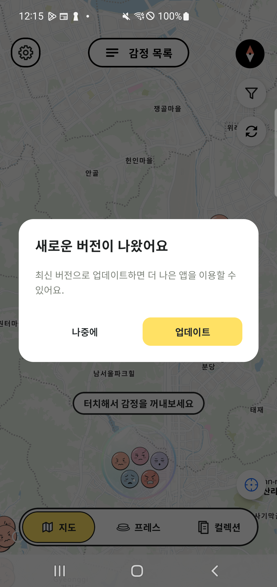
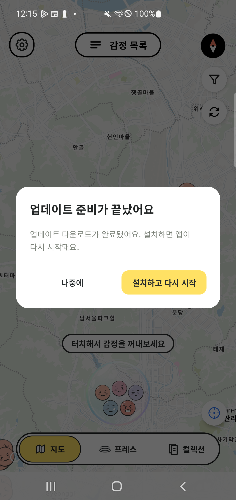

# #1032 구버전 사용자 대응 구현·검증 기록

검증일: 2026-10-29 KST. 구현 기준 커밋: `3c3203520b2dd5e21384bfd8b95ae238b6a84416`.
브랜치: `feat/1032-in-app-updates`. 기준 브랜치: `an/dev`, 시작 커밋 `f6c929412`.

클라이언트 구현과 USB 설치 기반 실기기 검증을 완료했다. **실제 Google Play 다운로드·업데이트 설치는 미검증**이다. 아래의 Debug 재현, Google Fake 테스트, USB 덮어 설치를 Play 검증으로 해석하지 않는다.

## 최소 지원 버전 기준과 근거

[서버 운영 문서](../../../../BE/docs/client/app-version.md)의 정책을 그대로 따른다. 앱이 지원 종료 버전을 임의로 정하거나 API에 중복 설정하지 않는다.

| 설치 버전과 서버 정책의 관계 | 동작 | 판단 근거 |
| --- | --- | --- |
| 설치 버전 < minSupportedVersion | 필수 안내, 주요 기능 차단, Android Immediate | 서버가 지원 대상에서 제외한 버전 |
| minSupportedVersion ≤ 설치 버전 < latestVersion | 권장 안내, 나중에 허용, Android Flexible | 서버의 지원 범위 안에서 최신 버전 권장 |
| 설치 버전 ≥ latestVersion | 정상 진입 | 최소 지원 조건과 최신 권장 조건 충족 |

버전의 major/minor/patch를 숫자로 비교한다. Play 설치 대상의 대소 비교는 versionCode를 사용하며 서로 혼동하지 않는다. 최소 버전 상향 전에 새 버전을 해당 사용자가 실제 설치할 수 있는지 확인하고, 변경·복구는 기존 SQL 절차를 따른다. 이번 작업에서 DB 정책은 변경하지 않았다.

### 실제 공개 API 관찰

정확한 시각과 원본 JSON은 [metadata.json](metadata.json)에 기록했다. 인증 없는 조회만 수행했다.

| 환경 | 응답 |
| --- | --- |
| 운영 `api.pheeeew.com` Android 정책 | 최소 `2.4.0`, 최신 `2.4.0`, 공식 Play URL |
| 개발 `api-dev.pheeeew.com` Android 정책 | `APP_VERSION-002` — 활성 정책 없음 |

운영의 현재 최소 지원 버전은 서버 응답인 **2.4.0**을 따른다. BE의 최신 `be/dev` 문서도 같은 운영 기준을 설명하지만, **2.4.0이라는 수치를 선택한 개별 API 비호환·데이터 손상·보안 사건의 근거는 해당 문서에 기재되어 있지 않다.** 이 클라이언트 작업에서 그러한 사유를 새로 만들어 기록하지 않았다. 제출 시 그 수치의 별도 선택 사유가 필요하면 BE 운영 변경 기록을 연결해야 한다.

아래 실기기 실험의 `2.5.0 / 2.6.0` 정책은 차단·권장 경계를 재현한 테스트 값이며 실제 운영 정책이 아니다.

## 구현한 동작

- Android AppUpdateManager를 Activity 수명에 연결했다. Play 가용 여부·허용 방식을 확인하고, 권장은 Flexible·필수는 Immediate로 요청한다.
- Flexible 다운로드 중·완료·설치 상태, Immediate 취소·실패·복귀를 처리한다. 재시도마다 새 AppUpdateInfo를 사용하고 중복 실행과 10초 이상 대기를 제한한다.
- Play 성공 콜백만으로 필수 차단을 해제하지 않는다. 실제 설치 버전과 서버 정책의 재평가가 차단 여부를 결정한다.
- Play 불가·실패·취소에는 재시도 및 서버 storeUrl 대체 경로를 제공한다. 스토어 이동 실패 메시지도 유지한다.
- Android/iOS에 마지막 정상 정책의 영속 캐시를 추가했다. 플랫폼·접속 환경·스키마를 분리하고 24시간 경과·미래 시각·손상 캐시를 배제한다.
- 현재 세션의 정상 판단은 재조회 오류로 해제하지 않는다. 정상 응답으로 최소 버전이 내려오면 즉시 복구한다. 캐시 없이 첫 조회가 실패하면 기존처럼 진입을 허용한다.
- 만료된 캐시만 있는 오프라인 재시작에서는 진입을 허용한다. 이 절충은 서버 문서의 확정 정책이 아니라 가이드에 따라 구현한 클라이언트 정책이다.
- 필수·권장·설치 완료 안내는 기존 닉네임 다이얼로그의 흰색 카드, 22dp 모서리, Noto Sans KR, 노란색 기본 버튼을 재사용한다.
- Debug 테스트 패키지의 정책 덮어쓰기와 Play 재현값은 실제 정상 정책 캐시에 저장하지 않는다.

## 빌드·기기 조건

| 항목 | 값 |
| --- | --- |
| 기기 | Galaxy S10 5G, SM-G977N, Android 12 |
| 테스트 패키지 | `com.pheeeew.updatetest` |
| 앱 표시 이름 | 히유 업데이트 테스트 A/B |
| 이전 버전 A | versionName `2.5.0`, versionCode `103201` |
| 업데이트 버전 B | versionName `2.6.0`, versionCode `103202` |
| 서명 | A/B 동일 Android Debug 서명. 인증서 SHA-256은 metadata.json 참조 |
| 설치 경로 | USB `adb install -r`, 운영 앱과 별도 패키지 |
| 테스트 계정 조건 | 별도 테스트 앱의 개발 서버 기기 세션 사용. Play 소유권·내부 공유 설치 조건은 미검증 |
| 위치 | 위치 권한을 허용하지 않고 지도 기본 화면으로 검증 |

테스트 B는 검증용 버전이며 공식 2.6.0 배포를 뜻하지 않는다. 일반 Debug/Release의 패키지와 버전 설정 `com.pheeeew / 2.5.0 / 13`은 유지했다. 테스트 패키지는 Firebase 프로젝트 미등록 상태이므로 토큰 요청을 실행하지 않는다.

APK SHA-256과 코드 커밋은 [metadata.json](metadata.json), 설치 버전 확인은 [A](device-A.txt)·[B](device-B.txt)에 기록했다. APK는 Git에 올리지 않고 로컬 `output/app-update-1032/`에 보관했다.

## 실기기 결과와 앱 화면

모든 화면은 같은 Galaxy 폰의 실제 앱에서 캡처했다. 정책/Play 재현 여부를 각 행에 구분했다.

| 확인 항목 | 조건과 결과 | 화면 |
| --- | --- | --- |
| A 설치 버전 | `2.5.0 / 103201`과 테스트 패키지 확인 | [A 설정](screenshots/00-test-config-A.png) |
| 최소 버전 미달 차단 | A에서 Debug 최소·최신 `2.6.0` → 필수 안내, 주요 화면 진입 차단 | [필수 안내](screenshots/01-required-A.png) |
| 취소 후 차단 | Debug Fake 취소 후에도 필수 안내 유지, 뒤로가기로 진입 불가, 재시도·스토어 경로 표시 | [취소 후](screenshots/02-required-canceled-A.png) |
| 조회 실패 시 판단 유지 | 필수 판단을 받은 같은 세션에서 Debug 정책 조회 실패 → 차단 유지 | [오프라인 재현](screenshots/07-offline-keeps-required-A.png) |
| 정책 하향 복구 | 같은 A 설치·세션에서 Debug 최소·최신 `2.5.0`으로 변경 후 전경 재조회 → 지도 진입 | [하향 복구](screenshots/08-policy-rollback-A.png) |
| 권장 안내 | A에서 Debug 최소 `2.5.0`, 최신 `2.6.0` → 권장 안내 | [권장 안내](screenshots/03-suggested-A.png) |
| 권장 미루기 | 나중에 선택 후 실제 지도·탭 UI 사용 가능 | [주요 화면](screenshots/04-later-main-A.png) |
| Flexible 완료 안내 | Debug Fake 다운로드 완료 → 설치/재시작 안내 표시. 실제 APK 설치 결과 아님 | [완료 안내](screenshots/05-flexible-downloaded-fake-A.png) |
| 실제 Play 요청의 복구 UI | USB 설치된 미등록 테스트 패키지에서 실제 AppUpdateManager 요청 실패/불가 → 차단 유지와 스토어 대체 경로 | [실패/불가](screenshots/06-play-unavailable-A.png) |
| 이전 A → 높은 B 직접 설치 | 동일 패키지·서명으로 B를 `adb install -r` 설치. 최소·최신 `2.6.0`을 유지한 상태에서 지도 정상 진입 | [B 주요 화면](screenshots/09-upgraded-B-main.png) |
| B 설치 버전 | `2.6.0 / 103202` 및 같은 필수 재현 정책 확인 | [B 설정](screenshots/10-test-config-B.png) |

실험 후 사용자가 계속 재현할 수 있도록 폰에는 다시 A를 설치했고, 권장 정책·Fake 취소가 선택된 테스트 설정 화면을 남겼다. 운영 앱은 교체하지 않았다.

### 대표 화면

필수 업데이트 차단:



권장 업데이트와 설치 준비 완료:





## 자동 검증

[검증 요약](validation-summary.txt), [Android 어댑터 기기 테스트 결과](adapter-instrumentation.txt).

- shared: **796개 통과**, 실패·오류·건너뜀 0.
- developerTools: **31개 통과**, 실패·오류·건너뜀 0.
- 실제 폰의 Google FakeAppUpdateManager + 프로덕션 Android 어댑터: **2개 통과**.
- ktlintCheck, Android lintDebug, 일반 Debug APK와 테스트 A/B APK 생성 통과.
- iOS Simulator 공통 소스 컴파일 통과. iOS 실기기 UI 검증은 수행하지 않았다.

추가 테스트는 정책 캐시 재시작·24시간 경계·플랫폼/환경/스키마/손상 분리, 잘못된 응답 보존, 캐시 저장 실패, 필수 판단 후 타임아웃 유지와 정상 하향 복구, Play 취소·실패·중복 요청·다운로드 복구·설치 상태를 다룬다.

```sh
# AN/Pheeeew에서 실행, Android SDK와 Android Studio 번들 JDK 사용
./gradlew ktlintCheck :shared:testAndroidHostTest :developerTools:testAndroidHostTest \
  :androidApp:lintDebug :androidApp:assembleDebug :shared:compileKotlinIosSimulatorArm64

# 테스트 A
./gradlew :androidApp:assembleDebug -PappUpdateTestBuild=true
# 테스트 B
./gradlew :androidApp:assembleDebug -PappUpdateTestBuild=true \
  -PappUpdateTestVersionName=2.6.0 -PappUpdateTestVersionCode=103202

# Debug 테스트 설정 화면
adb shell am start -n com.pheeeew.updatetest/com.pheeeew.AppUpdateTestActivity
# Google Fake 어댑터 테스트 (테스트 APK 설치 후)
adb shell am instrument -w -e class com.pheeeew.AppUpdateAdapterTest \
  com.pheeeew.updatetest.test/androidx.test.runner.AndroidJUnitRunner
```

## 후속 검증

1. 업데이트 기능이 포함된 A를 내부 앱 공유 등 Play 경로로 설치하고 같은 패키지·서명의 높은 B를 올린 뒤 Flexible/Immediate 다운로드·설치·재실행을 검증한다. [공식 절차](https://developer.android.com/guide/playcore/in-app-updates/test), 연계 #1019. 업데이트 기능이 없는 과거 설치 앱에 새 클라이언트 흐름을 소급 적용할 수는 없다.
2. 실제 테스트 DB의 최소/최신 정책을 SQL로 변경·복구하고 같은 설치 앱에서 재조회 결과를 확인한다. 이번에는 공개 API 관찰과 Debug 정책 재현까지만 수행했다. DB 변경 실험으로 완료 표시하지 않는다.
3. 서버가 운영 최소 `2.4.0`을 선택한 세부 근거가 제출 요구라면 해당 운영 변경 기록을 연결한다.
4. iOS의 스토어 이동·차단 UI와 실제 Play 진행 중 앱 종료/복귀를 배포 환경에서 확인한다. 공통 소스 컴파일·상태 테스트와 구분한다.

실제 Play 검증과 서버 SQL 변경 실험이 남아 있으므로 이 기록만으로 이슈 전체를 완료 처리하지 않는다. #1031과 통합할 때는 App.kt·Graph의 변경을 함께 확인한다.
