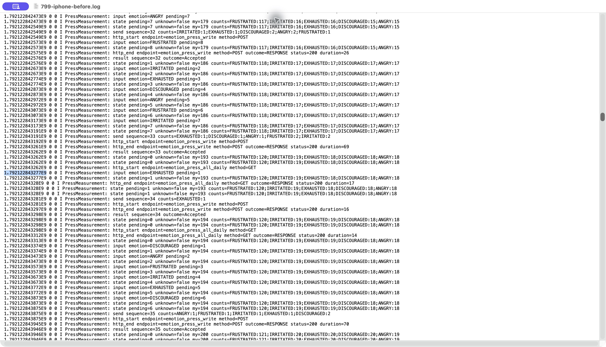
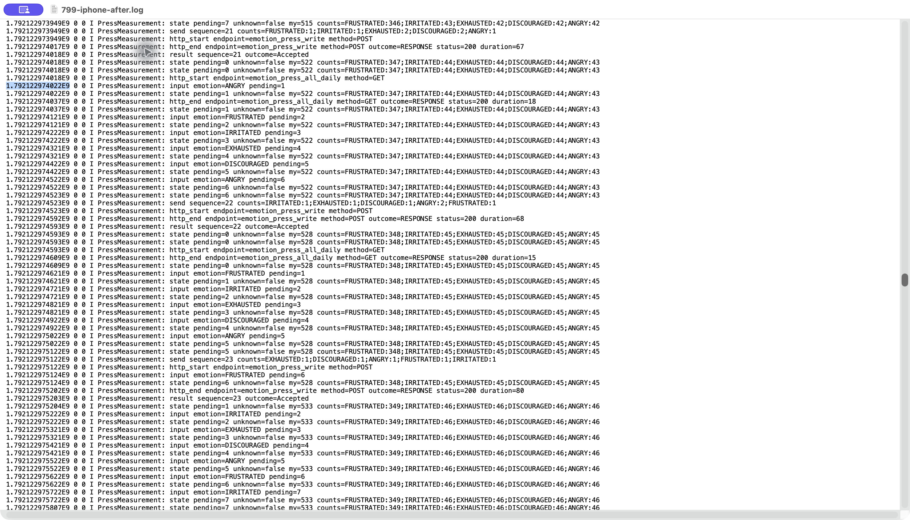
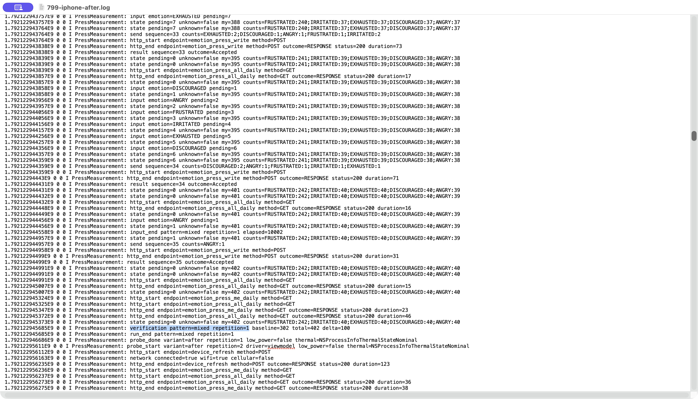

# 집계 조회 중 들어온 개인 프레스 입력의 묶음 대기 유지

이슈 #799는 전체 집계 조회 중 수용한 새 입력이 조회 종료만을 이유로 즉시 전송되는 경로를 수정한다. 최초 구현과 아래 실기기 측정 기준은 2026-10-16 an/dev의 547f0877이다. 2026-10-18에는 최신 an/dev 0f725625를 반영했다. 제품 전송 로직과 회귀 테스트를 변경했다. 실험용 장애 주입기나 기기 관측 코드는 추가하지 않는다.

## 원인과 변경

기존 워커는 POST 성공 후 전체 집계 GET을 기다린다. 이때 새 입력이 들어오면 accept의 500ms 전송 예약은 기존 워커가 실행 중이라는 이유로 생략된다. GET 완료 후 워커 finally가 남은 입력을 scheduleSend(0L)로 재개하여 묶음 대기를 우회한다. 보류된 집계 조회의 finally에도 같은 즉시 재개 경로가 있다.

수정 후에는 비어 있던 누적 버퍼가 첫 입력을 수용할 때 기본 500ms 대기의 종료 시각을 기억한다. 워커나 집계 조회가 완료되어 작업을 이어갈 때, 전송 중이던 고정 묶음이 없다면 새 입력의 남은 대기만 적용한다. 버퍼를 모두 꺼내면 종료 시각을 지우며 추가 입력은 첫 입력의 종료 시각을 다시 늦추지 않는다.

재시도 중인 고정 묶음은 기존처럼 즉시 재개하되 재시도 backoff는 지킨다. 명시적인 재시도·연결 복구 경로의 scheduleSend(0L)는 유지한다. 감정별 30회·전체 100회 임계값에 도달하면 남은 대기보다 먼저 전송할 수 있다. 기존 직렬 전송과 후속 요청 간격은 유지한다.

예를 들어 첫 POST가 t=500ms에 시작해 t=600ms에 끝나고, 집계 GET이 t=800ms까지 걸린다고 하자. t=650ms에 수용한 새 입력은 기존에는 t=800ms에 전송됐다. 수정 후에는 첫 입력 기준 종료 시각 t=1150ms까지 기다린다. 반대로 GET이 t=1600ms까지 걸렸다면 이미 종료 시각을 지났으므로 추가로 500ms를 기다리지 않는다.

## 재현과 회귀 검증

PressBatchWaitTest의 최초 재현 테스트가 기존 코드에서 실패하는 것을 확인한 뒤 수정했다. 다음 9개 테스트를 추가했다.

- 전체 집계 GET 도중 수용한 입력의 남은 대기를 유지한다.
- 조회 종료 전에 대기가 만료되면 추가 대기를 넣지 않는다.
- 추가 입력이 첫 입력의 종료 시각을 다시 늦추지 않는다.
- 조회 중 감정별·전체 임계값 도달 시 조기 전송한다.
- 조회가 끝난 뒤 남은 대기 중 임계값에 도달해도 즉시 깨어난다.
- 보류된 추가 집계 조회를 거쳐도 입력의 종료 시각을 보존한다.
- 오프라인 입력은 연결 복구 시 새 묶음 대기 없이 재개한다.
- 고정 묶음의 재시도는 Retry-After/backoff 종료 시 같은 묶음으로 재개한다.
- 집계 조회 지연이 있는 연속 입력을 비교하고 총 반영·대기 정리·최대 동시 전송 1개를 확인한다.

관련 프레스·Tap Android host 테스트 59개, 전체 ktlintCheck, androidApp assembleDebug를 통과했다. 추가로 iPhone 실기기에서 수정 전후를 각각 3회 비교했다. 조건과 결과는 아래에 구분해 기록한다.

## 같은 조건의 수정 전후 비교

비교 테스트는 초기 개인·전체 집계 조회가 끝난 상태에서 100ms 간격으로 100개 입력을 제시한다. POST 경계의 가짜 Sender 지연은 40ms, 전송 후 전체 집계 GET 지연은 50ms로 고정한다. 묶음 대기 500ms와 최소 후속 요청 간격 100ms 등 기본 설정을 유지한다. 같은 감정 100회와 다섯 감정 교차 각각 20회를 측정했다. 단조 시계와 가상 시간을 사용한다.

다음 두 입력 패턴은 같은 결과를 보였다. 전체 행과 묶음별 크기는 799-batch-wait-comparison.csv에 보존했다.

| 지표 | 수정 전 | 수정 후 |
|---|---:|---:|
| 수용·성공 반영 입력 | 100 | 100 |
| 논리 전송 수 | 32 | 17 |
| 1개 입력 묶음 | 18 | 0 |
| 평균 묶음 크기 | 3.12 | 5.88 |
| 입력 확인 지연 p50 | 280ms | 340ms |
| 입력 확인 지연 p95 | 680ms | 680ms |
| 최대 대기 입력 | 7 | 7 |
| 입력 창 종료 후 정리 | 180ms | 140ms |

논리 전송 수가 약 46.9% 감소하고 1개짜리 조기 전송이 사라졌다. p50은 60ms 증가했다. 묶음 대기를 지키므로 일부 입력을 더 기다리게 하는 교환 관계이며 모든 지연이 개선되었다고 해석하지 않는다. p95와 최대 대기는 이 조건에서 유지됐다. 1개짜리 묶음 자체를 금지하는 변경은 아니므로 단일 입력이나 마지막 잔여 입력은 계속 1개로 전송될 수 있다.

이 수치는 실제 HTTP POST 수나 앱·서버 성능 측정이 아니라 가짜 Sender의 호출 수와 로직의 확인 지연이다. #644의 실제 기기 결과와 직접적인 전후 비교로 사용하지 않는다. HTTP 인증 갱신·재전송·실제 네트워크 지연과 UI 렌더링 시간은 포함하지 않는다.

## 재실행

Android SDK가 설정된 환경의 AN/Pheeeew에서 실행한다.

```sh
./gradlew :shared:testAndroidHostTest --tests '*PressBatchWaitTest'
./gradlew ktlintCheck :androidApp:assembleDebug \
  :shared:testAndroidHostTest --tests '*Press*Test' --tests '*Tap*Test'
```

비교 결과는 shared/build/test-results/testAndroidHostTest/TEST-com.pheeeew.data.repository.press.PressBatchWaitTest.xml의 system-out에 BATCH_WAIT_PROBE 행으로 남는다. 수정 전 비교는 같은 테스트 파일을 기준 커밋 547f0877의 별도 체크아웃에 복사하고 compare continuous inputs with delayed statistics reads 테스트만 실행해 얻는다. 전체 회귀 테스트를 기존 코드에 실행하면 대기 우회 관련 테스트의 실패가 예상된다.

```sh
./gradlew :shared:testAndroidHostTest --tests '*PressBatchWaitTest.compare*'
```

## iPhone 실기기 비교 (2026-10-16)

iPhone 17 Pro(iOS 26.6), Debug 2.3.0+11, 개발 서버, Wi-Fi에서 측정했다. 모든 회차에서 저전력 모드는 꺼져 있었고 시작·종료 발열 상태는 Nominal이었다. 기준 커밋은 547f0877이며 전후 앱은 동일한 관측 코드와 설정을 사용하고 위 전송 로직 수정만 다르게 적용했다. 응답 지연을 주입하지 않은 실제 네트워크이므로 입력 조건은 같지만 서버 응답 시간까지 동일하지는 않다.

각 프로세스에서 단일 입력 1회 → 같은 감정 100회 → 다섯 감정 교차 100회를 실행했다. 연속 입력은 100ms 간격, 입력 창은 10,000~10,002ms였다. 실제 PressViewModel.onEmotionTap을 호출하며 실제 Repository·HTTP·서버 집계를 사용한다. 전용 Compose 화면에서 실행했으므로 손가락 터치 전달 지연이나 일반 화면의 애니메이션 지연을 측정한 결과는 아니다.

실행 순서는 수정 전 1회차 → 수정 후 1·2회차 → 수정 전 2·3회차 → 수정 후 3회차였다. 수정 전 3회차에서는 실험 사이에 자동 입력 외 5회가 관측돼 그 회차 전체를 비교에서 제외하고, 마지막에 다시 실행했다. 제외 로그도 799-iphone-before-3-excluded-extra-input.log에 보존했다. 분석 스크립트는 실험 밖 입력을 발견하면 실패하므로 해당 로그를 정상 결과로 조용히 포함하지 않는다.

각 실험 전에 개인·전체 집계를 새로 조회하고 대기·조회·전송이 끝난 뒤 입력을 시작했다. 종료 후에도 집계를 재조회해 총 증가량과 감정별 증가량을 검증했다. 최종 선택한 전후 각 9개 실험에서 수용 603회 = 성공 확인 603회 = 개인 집계 증가 603회였고, 남은 대기와 처리 불명은 모두 0이었다. 단일 입력을 제외한 연속 입력은 버전별 600회다.

표의 범위는 3회 각각의 결과 최솟값~최댓값이며, 회차별 p95를 합친 전체 p95가 아니다.

| 입력·지표 | 수정 전 | 수정 후 |
|---|---:|---:|
| 같은 감정 100회 POST 수 (회차 순) | 17 / 18 / 17 | 17 / 17 / 17 |
| 교차 감정 100회 POST 수 (회차 순) | 18 / 18 / 19 | 17 / 17 / 17 |
| 연속 입력 600회 POST 합계 | 107 | 102 |
| 연속 입력에서 500ms 미만 대기한 1개 묶음 | 5 | 0 |
| 같은 감정 확인 p50 | 324~328ms | 322~347ms |
| 같은 감정 확인 p95 | 532~604ms | 531~601ms |
| 교차 감정 확인 p50 | 327~346ms | 326~375ms |
| 교차 감정 확인 p95 | 603~652ms | 556~655ms |
| 연속 입력 최대 대기 | 7~8개 | 7~8개 |
| 같은 감정 입력 종료 후 정리 | 131~370ms | 122~335ms |
| 교차 감정 입력 종료 후 정리 | 432~555ms | 156~432ms |
| 연속 입력 회차별 평균 POST 응답 시간 | 25~54ms | 23~60ms |
| 단일 입력 성공 확인 | 527~542ms | 528~579ms |

연속 입력의 POST는 약 4.7% 감소했다. 수정 전 조기 1개 묶음 5건은 입력 후 각각 4/18/14/3/17ms에 전송됐고, 모두 입력 시점이 전체 집계 GET 구간 안에 있었으며 GET 종료 1ms 뒤에 전송됐다. 수정 후 연속 입력에 남은 1개 묶음 2건은 각각 501ms 기다린 잔여 입력이었다. 목표로 삼은 대기 우회 경로가 실제 기기에서도 재현되고 수정 후 사라진 결과다.

이 환경에서는 수정 전에도 대부분 5~7개가 묶여 전송되어 가상 실험보다 요청 감소 폭이 작았다. 확인 p95와 최대 대기의 뚜렷한 개선은 관측하지 못했고 일부 회차는 더 느렸다. 실제 응답 변동과 반복 횟수 3회의 한계가 있으므로 지연 개선이나 다른 네트워크에서의 동일 효과를 단정하지 않는다. 장애·재연결 회귀는 위 로직 테스트로 확인했으며 이번 iPhone 비교에는 장애를 주입하지 않았다.

### 핵심 로그 이미지

아래 이미지는 원본 .log 파일을 macOS 텍스트 편집기에서 연 실제 화면 캡처다. 이미지 재구성·로그 생략·색상 꾸밈 없이 앱 창 그대로 저장했다. 파란 선택 표시는 편집기의 검색 결과다. 서로 다른 회차의 대표 사례이며 개별 응답 시간을 동일하게 맞춘 비교는 아니다. 이미지를 열어 확대하면 원문을 읽을 수 있다.

**수정 전: 조회가 끝나자 1개 입력을 즉시 전송**

[수정 전 원본 로그](799-iphone-before.log)의 738~747행이다. 입력 수용 시각은 1.792122843277E9, 전송 시작은 1.792122843281E9로 차이는 4ms다. 전체 집계 GET은 그 사이에 끝났고, 종료 1ms 뒤에 전송됐다.



**수정 후: 조회가 끝나도 남은 대기를 지켜 6개를 묶어 전송**

[수정 후 원본 로그](799-iphone-after.log)의 1249~1268행이다. 첫 입력 수용 시각은 1.792122974022E9, 전송 시작은 1.792122974523E9로 501ms 기다렸다. GET 종료 후 추가 입력을 수용했고, counts 합계 6개를 한 번에 전송했다.



**서버 집계 확인: 교차 입력 100회의 증가량 검증**

수정 후 교차 입력 1회차 종료 구간의 실제 화면이다. verification 행의 baseline=302, total=402, delta=100으로 입력 100회와 서버 집계 증가량이 일치한다. 바로 앞에는 재조회 응답과 pending=0 상태도 보인다. 전체 3회씩의 검증 결과는 위 결과표와 CSV에 기록했다.



### 자료와 분석 재실행

- 799-iphone-before.log / 799-iphone-after.log: 측정 이벤트만 추출한 원본 로그. 기기 식별자·인증 정보·일반 앱 콘솔은 제외했다. 원본 시각의 지수 표기를 보존한다.
- 799-iphone-before.csv / 799-iphone-after.csv: 기존 summarize_device.py로 검증·집계한 회차별 결과.
- 799-iphone-comparison.csv: 묶음 수·평균 크기·1개 묶음 대기를 추가한 비교표. confirmation은 입력 수용→POST 성공 응답 처리, singleton_wait_ms는 입력 수용→논리 전송 시작이다.
- summarize_799_iphone.py: 전후 각 3회 종료와 실험 밖 입력 부재를 검사하고, 임시 입력에서만 시각 표기를 정규화해 기존 분석기를 호출한다.

이 폴더에서 실행한다. 원본 폴더를 결과 폴더로 덮어쓰지 않고 별도 경로에서 결과를 비교할 수 있다.

```sh
python3 summarize_799_iphone.py . ./summarize_device.py /tmp/press-799-reanalyzed
```

원본 기기 측정은 별도 로컬 브랜치 feat/799-iphone-comparison-reproduction에서 관측 콜백·자동 입력 화면을 추가해 수행했다. 제품 작업에는 이 관측 코드를 포함하지 않는다. 당시 수정 전 앱은 547f0877에 관측 코드만 적용하고, 수정 후 앱은 같은 상태에 #799 변경을 추가했다. 대기 500ms·감정별 30개·전체 100개를 양쪽에 동일하게 적용했고 각 패턴 사이에 조회·대기 정리를 확인했다.

해당 실험 브랜치의 현재 작업 상태에는 이후 다른 후보를 측정한 변경도 누적되어 있으므로, 그대로 빌드해서 당시 before/after 앱을 재현할 수 있다고 보장하지 않는다. 실기기 재측정은 관측 코드와 위 두 빌드 조건을 복원하여 별도로 수행해야 한다. 원본 로그와 CSV 재분석은 위 명령만으로 가능하다. 아래 바이너리 해시는 실제 측정 당시 빌드의 식별값이다.

이번 서명된 앱의 Pheeeew.debug.dylib SHA-256:

- 수정 전: 67e2cb86b17d27332a3016cbf9550086520c803a888b0e75a985cd5aebc04199
- 수정 후: f2e5459f1ddf8ea023767730c41b26018657f3344808c5f4560e3266e47ac735

## 최신 an/dev 반영 후 재검증 (2026-10-18)

feat/799-preserve-press-batch-wait를 origin/an/dev 0f725625f50c741a3f2e8131b5eb9a08d6dfe9ef로 fast-forward하고 기존 #799 수정·테스트를 충돌 없이 다시 적용했다. 기준 이후 15개 커밋을 반영했으며 프레스 Repository의 기존 기본 설정은 유지했다.

```sh
ANDROID_HOME=/Users/USER/Library/Android/sdk ./gradlew ktlintCheck :androidApp:assembleDebug \
  :shared:testAndroidHostTest --tests '*Press*Test' --tests '*Tap*Test'
```

- Gradle BUILD SUCCESSFUL. 관련 테스트 59개, 실패·오류·건너뜀 0개. 이 중 PressBatchWaitTest 9개다.
- 전체 ktlintCheck와 Android Debug APK 빌드 성공.
- 최신 실행의 BATCH_WAIT_PROBE 두 행이 저장된 after CSV의 전송 수·묶음 크기·p50·p95·최대 대기·정리 시간과 모두 일치했다. 두 입력 패턴 모두 전송 17회, p50 340ms, p95 680ms, 최대 대기 7개, 정리 140ms다.
- 기존 iPhone 원본 로그를 재분석하여 CSV 3개의 모든 행이 동일함을 확인했다. 원본 로그·기존 CSV·실제 화면 캡처도 분리 전 보존본의 SHA-256과 일치한다.
- 문서의 로컬 링크와 git diff --check를 확인했다.

이번 최신화 후 실기기 측정을 새로 수행하지는 않았다. 위 iPhone 수치는 2026-10-16의 547f0877 기준 직접 전후 측정이며, 최신화 후 재실행한 가상 시간 테스트·빌드 결과와 구분한다.

500ms/750ms/1초 후보 비교, 전송 전략 탐색, 백그라운드·종료·복구 후속 실험은 제품 변경에서 제외하고 별도 실험 브랜치에 해시 검증된 보존본으로 분리했다. 이 문서와 PR 대상에는 #799 직접 비교만 남긴다.
