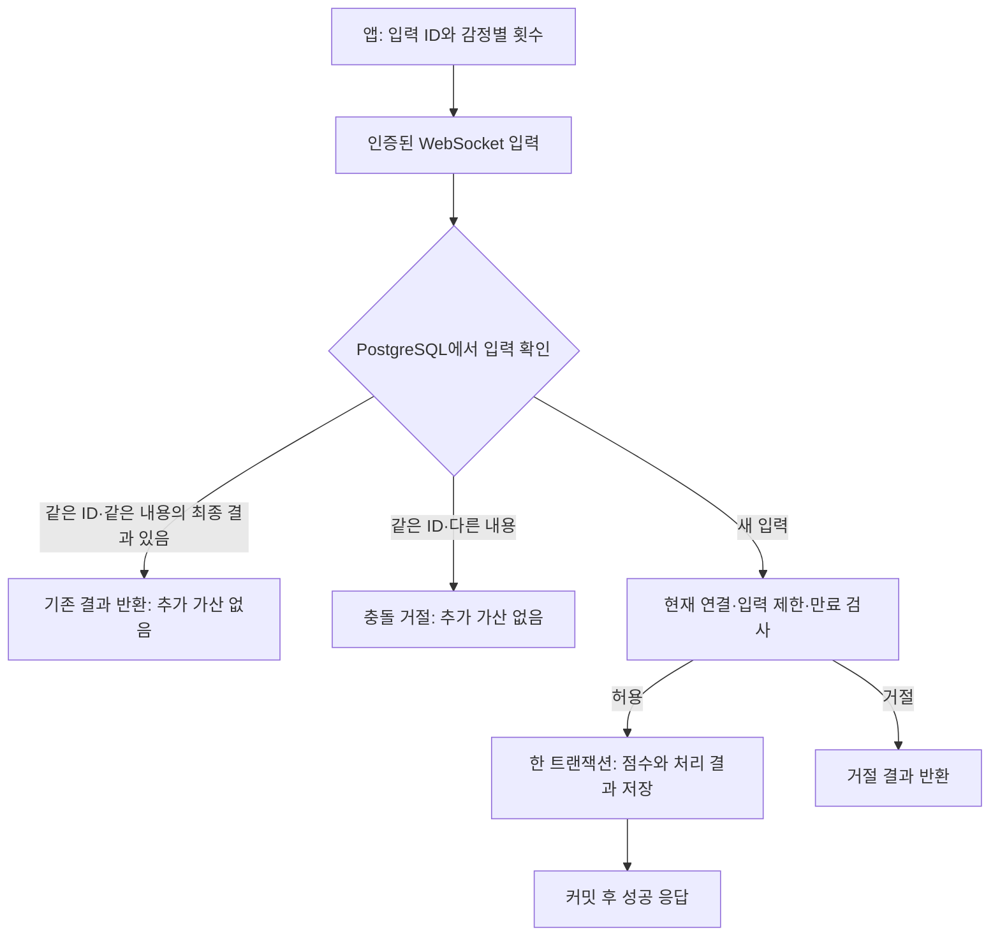

# 실시간 프레스 입력·만료·복구 계약 검토 (#919)

## 상태와 범위

- 초기 설계 계약 v1 사용자 승인 완료 (2026-10-26). 다섯 검토 묶음과 명시된 시간 보장 한계를 수용했다. GitHub 반영·이슈 종료·구현·실제 검증은 별개다.
- 공통 명세: [#918](https://github.com/woowacourse-teams/2026-pheeeew/issues/918).
- 설계 게이트: [#919](https://github.com/woowacourse-teams/2026-pheeeew/issues/919).
- 이 문서는 제품 코드·스키마 구현, 테스트·부하 실행, Git 게시 또는 배포 승인을 뜻하지 않는다.

## 초기 버전의 설계 요약

초기 버전은 저장·중복 방지·복구에 필요한 구성으로 제한한다. 순번·누적 ACK·슬라이딩 윈도는 도입하지 않는다. 미확인 입력 20묶음 제한을 사용하며 순번 기반 미정산 구간 제한은 사용하지 않는다.



- 저장 대상은 기존 프레스 집계, 입력 처리 기록, 기기별 현재 연결 세대다. 연결 이력 전체·별도 메시지 브로커·입력 워커는 추가하지 않는다.
- 입력 중복 판단은 인증된 기기와 입력 ID를 기준으로 하며, 동시 요청도 DB 제약·잠금으로 중복 반영을 막아야 한다. 위 그림의 선조회만으로 보장되는 것은 아니다.
- 클라이언트는 최초 전송부터 10초 미만 재시도, 10초 이상 20초 미만 결과 확인을 수행한다. 서버의 신규 반영 마감은 최초 DB 접수부터 10초이며 재전송으로 연장하지 않는다.
- 연결이 정상이고 결과 미확인 입력이 20묶음 미만이면 새 입력을 허용한다. 연결 이상 시에는 기존에 합의한 연결 교체·미확인 입력 정산·확정 점수 복구 절차를 적용한다.
- 초기에는 입력 처리 기록의 자동 삭제를 보류한다. 20초 TTL, 연결 종료 후 24시간 TTL, 결과 확인용 추가 ACK, 정산 완료 번호 기반 삭제는 채택하지 않는다. 이는 영구 보관을 제품 정책으로 확정한다는 뜻이 아니며, 안전한 삭제 조건과 기록량 확인을 후속 과제로 남기는 초기 운영 방향이다.

## 저장 데이터

| 구분 | 내용 | 목적 |
| --- | --- | --- |
| 기존 프레스 집계 | 기기·날짜·감정별 누적 횟수 | 실제 점수 원천 유지 |
| 입력 처리 기록 | 기기·입력 ID, 입력 내용 확인 정보, 최초 수신 시각, 처리 상태·결과 | 중복 방지, 마감 유지, 결과 재확인 |
| 기기별 현재 연결 세대 | 현재 유효한 연결을 구분하는 값 | 이전 연결의 늦은 신규 저장 차단 |

실제 테이블·컬럼·제약 구성은 후속 설계 대상이다. 최초 수신 시각의 지속성 및 처리 결과·점수의 원자 저장을 모두 충족해야 한다.

## 승인된 입력 저장 방향

2026-10-26 승인: PostgreSQL 직접 저장을 초기 구조로 사용한다.

- 입력은 Kafka 또는 Redis 큐를 거치지 않고 PostgreSQL에서 직접 처리한다.
- 최초 DB 접수 시각과 입력의 동일성을 보존하는 `PENDING` 기록은 짧은 선행 트랜잭션으로 먼저 커밋한다. 이후 점수 증가와 해당 기록의 최종 처리 결과 확정은 같은 후속 트랜잭션에서 수행하고, 그 커밋 후 성공 결과를 보낸다.
- 부모 명세의 점수·중복 결과 원자 저장은 후속 트랜잭션의 점수 변경과 `APPLIED` 결과 확정에 적용한다. 선행 `PENDING` 커밋은 점수 반영 성공이 아니며, 후속 트랜잭션이 롤백돼도 최초 접수 기록은 남는다. 접수와 최종 처리를 한 트랜잭션으로 합치지 않는다.
- 성공 응답이 유실되어 같은 입력이 재전송되면 기존 결과를 반환하고 점수와 활동 시각을 추가 갱신하지 않는다. 입력 식별자와 내용 충돌의 구체적인 계약은 후속 검토 대상이다.
- 이번 입력 경로에는 Kafka·Redis 큐를 도입하지 않는다. 순위 계산·전파 등 다른 용도의 Redis 채택 여부까지 결정한 것은 아니다.

### 승인된 최소 저장 구조

2026-10-26 승인: 기존 프레스 집계·입력 처리 기록·현재 연결 세대를 사용한다.

- 기존 프레스 테이블은 기기·날짜·감정별 누적 집계를 유지한다.
- 별도 입력 처리 기록에는 인증된 기기와 입력 식별자, 입력 내용의 동일성 확인 정보, 최초 수신 시각, 처리 결과를 관리한다. 점수 반영과 최종 처리 결과는 같은 트랜잭션에서 확정한다. 정확한 스키마·유니크 키 구성과 최초 수신 시각 보존 절차는 후속 설계 대상이다.
- 재연결 시 이전 연결의 쓰기 차단에는 기기별 현재 연결 세대를 사용한다. 연결 이력 전체를 보관하는 구조를 기본 요구로 두지 않는다. 모든 쓰기 경로에서 세대 검사와 실제 저장의 원자성을 지켜야 한다.
- 앞서 제안했던 연결 종료 후 24시간 보존은 채택하지 않았다. 입력 처리 기록의 보존·정리는 이 구조를 기준으로 별도 결정한다.

이 구조는 선행 접수 기록을 유지하면서 최종 처리 결과와 비즈니스 변경을 같은 DB 트랜잭션에서 확정해 중복 반영을 막는 Idempotent Consumer의 원리를 적용한다. Transactional Inbox 관점으로 설명할 수 있지만, 입력을 먼저 접수한 뒤 별도 워커가 처리하는 비동기 큐를 도입한다는 의미는 아니다. 참고: [Idempotent Consumer 패턴](https://microservices.io/patterns/communication-style/idempotent-consumer.html).

### 선택 근거와 한계

큐 도입만으로 앱에서 서버까지의 전송 실패나 DB 커밋 뒤 성공 응답 유실을 해결할 수는 없다. PostgreSQL 중복 방지는 큐를 사용하더라도 필요하므로, 먼저 부모 명세의 원자 저장과 커밋 후 응답 구조를 유지한다.

DB 저장 전 서버가 종료되면 앱의 재시도가 필요하다. 서버 메모리에 도착한 입력의 무조건적인 보존이나 DB 장애 중 지속 접수는 보장하지 않는다. 실제 처리량·지연은 아직 검증하지 않았다.

## 승인된 신규 반영 유효기간

2026-10-26 승인: 앱 최초 전송 10초·서버 최초 DB 접수 10초를 각각 적용한다.

- 미처리 입력의 신규 반영 유효기간은 10초로 정한다. 이미 저장된 입력의 결과를 확인하는 기간과 구분한다.
- 앱의 자동 재시도는 해당 입력의 최초 전송 시각부터 10초로 제한한다. 부모 명세의 최대 5분 자동 재시도는 이번 결정으로 대체한다. 이후 결과 확인은 아래의 별도 기간을 적용한다.
- 서버의 신규 반영 유효기간은 해당 입력의 최초 DB 접수 시각부터 10초다. 동일 입력의 재전송으로 최초 접수 시각이나 마감을 갱신하지 않는다.
- 서버는 필요한 잠금을 확보한 뒤 새로 얻은 서버 시각이 마감 미만인지 확인하고 신규 반영을 승인한다. 마감 시각과 같거나 늦으면 아직 미처리인 입력의 신규 반영을 거절한다. 마감 전에 승인된 트랜잭션은 마감 이후 커밋될 수 있다.
- 이미 저장된 입력은 신규 반영 마감이 지나도 보존된 결과를 반환하며, 점수와 활동 시각을 추가 갱신하지 않는다.
- 네트워크 지연으로 서버의 첫 수신이 늦어질 수 있으므로, 앱 최초 전송부터 정확히 10초 이후 신규 반영이 없다는 보장은 하지 않는다. 서버가 사전에 발급하는 입력 마감은 도입하지 않는 방향으로 합의했다.
- 초기에는 처리 기록을 자동 삭제하지 않는다. 이후 안전한 정리 조건과 보존 기간은 별도로 결정한다.

## 승인된 앱의 자동 복구 기간

2026-10-26 승인: 결과 확인은 추가 10초로 제한한다. 결과 확인 5분은 사용하지 않는다.

- 최초 전송부터 10초 미만에는 동일 입력 식별자·내용으로 자동 재시도한다. 확정 성공이나 최종 거절이 확인되면 즉시 종료한다.
- 최초 전송부터 10초 이상 20초 미만에는 미확인 입력의 처리 결과만 조회한다. 이 조회는 새로운 입력 등록이나 점수 가산을 수행하지 않는다.
- 최초 전송부터 20초가 되면 자동 복구 시도를 멈추고 연결 오류를 표시한다. 이 시각은 앱의 자동 시도 상한이며 서버 처리 완료의 보장은 아니다. 늦게 도착한 응답과 이미 진행 중인 서버 작업이 취소된다는 뜻도 아니다.
- 20초 안에 결과가 확인되지 않았다는 이유로 성공이나 실패를 확정하지 않는다. 미확인 입력을 새 식별자로 다시 보내 점수를 추가하지 않는다.
- 자동 복구 종료 시각과 서버의 처리 결과·중복 방지 기록 삭제 시각은 별개다.

## 승인된 미확인 입력의 병행 전송

2026-10-26 승인: 연결이 정상일 때 여러 미확인 입력을 동시에 허용하고 대기 상한에 도달하면 새 입력을 막는다. 부모 명세의 전송 실패 시 새 입력 차단을 아래와 같이 구체화·변경한다.

- 연결이 정상이고 결과 미확인 입력이 20묶음 미만이라면, 앞선 입력의 성공 응답을 기다리지 않고 새 입력을 보낼 수 있다. 입력마다 고유 식별자를 부여하고 각 입력의 결과 확인·재시도 기간을 독립적으로 관리한다.
- 대기 개수 상한은 결과 미확인 입력 20묶음이다. 누른 횟수나 하루 점수 상한과 구분하며, 같은 입력의 재전송은 새 묶음으로 세지 않는다. 직렬화 크기 상한은 아래 연결 설정의 64KiB를 함께 적용한다.
- 미확인 입력이 상한에 도달하면 새 입력을 일시 중단한다. 기존 입력의 재시도·결과 확인은 각 입력의 승인된 기한 안에서 계속할 수 있어야 한다.
- 연결 끊김, 인증 만료, 서버의 명시적 입력 중단과 개별 입력의 응답 미확인은 구분한다. 전자는 기존 명세의 입력 중단 조건을 유지한다.
- 입력 전송 순서대로 성공 응답이 도착하거나 반영된다고 가정하지 않는다. 기존의 서버 점수 도달 순서·스냅샷 버전 계약은 유지하며, 늦은 응답이 더 최신의 화면 상태를 과거 값으로 덮어쓰지 않아야 한다.

## 승인된 연결 이상 시 복구 방향

2026-10-26 승인: 여러 입력의 결과가 계속 오지 않아 최종 20초 상한에 도달하면 재연결하고, 서버 최신 상태와 미확인 결과를 확인한 뒤 새 입력을 재개한다.

- 20초는 정상적인 응답 대기 목표가 아니라 자동 복구의 최종 상한이다. 알려진 연결 끊김이나 인증 만료 시에는 즉시 새 입력을 중단하고, 미확인 입력이 20묶음에 도달해도 그 시점부터 새 입력을 일시 중단한다.
- 특정 입력만 미확인이고 이후 다른 입력은 정상 응답을 받는 경우, 해당 입력의 복구를 독립적으로 수행한다. 그 입력 하나의 지연만으로 전체 연결 장애라고 단정하지 않는다.
- 여러 입력의 응답이 계속 오지 않는 경우, 가장 먼저 미확인 상태인 입력의 최초 전송부터 20초가 되면 새 입력을 중단하고 연결 오류·재연결 상태로 전환한다. 뒤의 새 입력 때문에 이 상한을 연장하지 않는다.
- 재연결 후 서버 최신 상태와 미확인 입력의 처리 결과를 확인해 화면을 정산한 뒤 새 입력을 재개한다. 재연결은 과거 입력의 자동 재시도 기간을 다시 시작하거나 새 입력 식별자를 발급해 재가산하는 수단이 아니다.
- 20초 경과 또는 재연결만으로 미확인 입력의 성공·실패를 확정하지 않는다. 다음의 정산 조건을 충족해야 한다.

## 승인된 재연결 정산과 입력 재개

2026-10-26 승인: 이전 연결의 쓰기를 정리한 뒤 미확인 입력을 정산하고 확정 점수로 다시 시작한다.

1. 인증된 새 연결은 해당 기기의 이전 연결을 교체한다. 입력 저장과 연결 교체가 공유하는 DB 직렬화 지점에서, 이미 쓰기 자격을 얻은 이전 트랜잭션의 커밋·롤백을 기다리고 연결 세대를 교체한다. 이후 뒤늦게 잠금을 얻은 이전 연결의 요청도 같은 저장 경계에서 세대를 검사해 거절해야 한다. 소켓 종료만으로 저장 중인 작업이 취소됐다고 가정하지 않는다.
2. 이전 연결의 추가 반영이 차단된 뒤, 같은 잠금·정산 트랜잭션에서 해당 기기의 닫힌 연결 세대에 남은 `PENDING`을 모두 `REJECTED/NOT_APPLIED_ON_RECOVERY`로 확정한다. 이미 커밋된 `APPLIED`·`REJECTED`는 원래 결과를 유지한다. 앱이 목록을 잃은 경우에도 남은 `PENDING`을 정리할 수 있도록 요청 목록에 있는 입력에만 한정하지 않는다. 미확인 입력별 결과와 서버의 확정 점수는 이 정산을 포함한 같은 DB 관찰 상태로 반환하고, 정산 커밋 후 입력을 재개한다.
3. 해당 입력이 처리됐을 수 있는 전체 기간의 결과·중복 이력이 삭제 없이 보존됐고, 이전 연결의 추가 쓰기도 불가능함을 보장할 때에만 기록 없는 입력을 미반영으로 종결한다. 단순 조회 실패, 기록 보존 기간 경과, 최신 합계 조회만으로 이 조건을 충족했다고 판단하지 않는다.
4. 앱은 입력별 결과와 확정 점수로 임시 표시를 정산한 뒤 새 입력을 재개한다. 미반영 입력을 새 식별자로 자동 재전송하지 않는다. 날짜·버전이 더 오래된 응답으로 최신 상태를 덮어쓰지 않는다.
5. DB 장애나 교체·이력 보존 조건 미충족으로 정산할 수 없다면 새 입력 중단·재연결 상태를 유지하고 결과는 미확인으로 둔다. 구체적인 재연결 시도 간격·수동 복구 수단은 아직 미정이다.

이 절차는 architect의 조건부 설계 검토를 반영했다. 구현·동시성 검증을 마쳤다는 뜻은 아니며, 상세 잠금 구조와 처리 이력의 보존·정리 방식을 결정한 뒤 실제 PostgreSQL/PostGIS 통합 검증이 필요하다.

## 나머지 초기 설계 계약 — 사용자 승인 완료

이하 내용은 2026-10-26 승인된 초기 계약이다. 정상 반영은 95% 1초 목표이며 아직 검증 전이다. 서버의 10초는 DB 최초 접수 기준이므로 네트워크에서 지연된 첫 요청의 늦은 반영까지 금지하지는 않는다. 아래 ‘추천·시작값’은 채택한 초기 설정이며 성능을 증명한 숫자가 아니다. 실제 앱 지원 확인·구현 검증·운영 실행 승인은 포함하지 않는다.

### 1. 저장 모델과 최초 수신

현재 코드는 `device_daily_presses`의 기기·날짜·감정별 합산이며 입력별 처리 기록이 없다. 컬렉션도 이 테이블을 읽으므로 원천을 유지하고 필요한 상태만 추가한다.

| 논리 상태 | 추천 내용 |
| --- | --- |
| 기존 감정별 프레스 | 현재 테이블을 유지하고 실제 인정량만 증가 |
| 입력 처리 기록 | `(device_id, request_id)` 유니크, 정규화한 입력 내용, 최초 수신 시각, 원래 연결 세대, `PENDING/APPLIED/REJECTED`, 원래 결과 |
| 기기별 제어 | 현재 연결 세대·준비 여부, HTTP·WS 공통 프레스 제한 잔여량·충전 시각 |
| 기기·날짜별 경쟁 투영 | 전체 감정 합계, 현재 점수 도달 번호, 마지막 신규 적용 시각, 인증 ID와 무관한 일일 공개 ID |
| 공통 제어 행 | 활성 서버 세대, 영속 변경 번호, 경쟁 활성화 기준 날짜·중단 상태 |

물리 테이블·이름·인덱스는 #920에서 최소 구성으로 확정한다. 이 문서는 스키마를 구현하지 않는다. 경쟁 투영은 기존 집계와 같은 트랜잭션에서 갱신하고 합계 불일치를 검증한다.

**최초 수신의 지속성:** 점수 저장이 롤백돼도 10초 마감은 연장되지 않아야 한다. 유효한 인증·입력 ID·내용을 짧은 별도 DB 트랜잭션으로 먼저 `PENDING` 등록하고, 이어지는 실제 처리 트랜잭션에서 점수와 최종 결과를 함께 확정하는 안을 추천한다. 큐·소비 워커는 추가하지 않고 같은 요청 흐름에서 바로 처리를 시도한다.

- 최초 수신 기준은 첫 영속 접수 트랜잭션에서 얻은 DB 시각이며, 그 값을 변경하지 않는다. 동시 중복은 첫 영속 등록 하나를 유지한다. **DB 등록 전 대기·crash의 최초 소켓 수신 시각은 복원·보장하지 못한다.** 소켓 수신에서 영속 접수 기준으로 구체화하는 변경과 이 한계를 사용자가 수용했다. 앱 최초 전송부터 정확히 10초의 보장으로 바꾸지 않는다.
- 첫 등록과 처리는 별개 트랜잭션이므로 실패 후 `PENDING`만 남을 수 있다. 같은 ID 재시도·상태 조회·재연결 정산으로 처리하며, 재시작만으로 최초 수신 시각을 다시 만들지 않는다.

| 입력 상태 전이 | 조건 | 점수·활동 변경 |
| --- | --- | --- |
| `PENDING → APPLIED` | 현재 서버·소켓·입력 세대와 마감·인증·제한 검사 통과 후 실제 적용 트랜잭션 커밋 | 인정량과 최종 결과를 원자적으로 반영 |
| `PENDING → REJECTED` | 같은 잠금에서 최종 입력 거절·만료를 확정 | 없음 |
| 닫힌 세대의 `PENDING → REJECTED/NOT_APPLIED_ON_RECOVERY` | 진행 중 저장의 커밋·롤백을 기다리고 이전 세대의 추가 쓰기를 차단한 복구 트랜잭션 | 없음 |
| `PENDING` 유지 | 후속 처리 트랜잭션의 롤백이 확인됨 | 점수는 반영되지 않고 선행 접수 기록은 유지 |

- 복구 잠금을 얻기 전에 기존 적용이 커밋됐다면 이미 `APPLIED`이며 원래 결과를 반환한다. 그 뒤에도 `PENDING`이라면 점수와 성공 결과의 원자성 때문에 커밋된 점수는 없으므로, 이전 세대의 추가 쓰기 차단 후 미반영 거절로 확정할 수 있다. 마감 경과만으로 판정하는 것과 구분한다. 닫힌 세대의 입력을 새 세대로 옮겨 가산하지 않는다.
- 복구 거절은 원래 입력 내용·최초 접수 시각을 보존하고 점수·활동·프레스 제한을 소비하지 않는다. 정산 트랜잭션의 롤백이 확인되면 상태 변경도 반영되지 않고 `PENDING`을 보존한다. DB 복구 후 같은 정산 절차를 재시도하며 입력 중단 상태를 유지한다. 초기 자동 삭제 보류가 이 기록에도 적용된다.
- DB 연결 단절 등으로 커밋 여부 자체가 불명확하면 `PENDING`이나 실패로 단정하거나 상태를 되돌리지 않는다. DB 재조회와 복구 잠금에서 실제로 커밋된 `APPLIED/REJECTED` 또는 남아 있는 `PENDING`을 확인해 종결한다.

공통 잠금 순서는 선행 접수·후속 적용·복구 정산 모두 공유한다. 아래의 `READY` 및 입력 원래 세대와 현재 세대의 일치 조건은 신규 접수·점수 가산의 자격이다. 복구는 인증된 현재 연결의 `RECOVERING` 상태에서 진행하며, 닫힌 원래 세대의 `PENDING`을 가산하지 않고 최종 거절로 종결한다.

- 신규 `PENDING` 등록부터 실제 적용까지, 서버가 해당 소켓에 고정한 활성 서버·연결 세대와 DB의 현재 세대 및 `READY` 상태를 같은 잠금에서 검사한다. 입력 본문의 세대를 쓰기 자격으로 신뢰하지 않는다. 실제 가산에는 `socketBoundGeneration = input.originalGeneration = DB.currentGeneration`이 모두 필요하다. 최종 결과 조회는 새 인증 연결에서도 허용하지만, 기존 `PENDING`의 원래 세대를 새 세대로 옮기지 않는다.
- 추천 잠금 순서는 공통 제어 행 → 기기 제어 행 → 입력 행 → 감정명 순서다. 최초 등록·연결 교체·복구·서버 교체도 같은 순서를 따른다. 실패한 JPA 트랜잭션에서 제약 위반을 잡은 뒤 계속 저장하지 않는다.
- 같은 ID·같은 내용의 최종 결과는 재반환한다. 같은 ID·다른 내용은 `INPUT_CONFLICT`이며 기존 결과를 덮어쓰지 않는다. ID는 연결 교체로 재사용 가능해지지 않는다.
- 다섯 감정의 정수 횟수를 정규화해 비교하고 누락 감정과 0은 같게 본다. 알 수 없는 감정·중복 JSON 키·음수·소수·정수 범위 초과는 거절한다. 해시와 함께 정규화 내용도 보관한다.
- 실제 적용 직전 잠금 획득 후 새 시각으로 활성 서버·연결 세대, JWT `exp`, 입력 마감을 검사한다. 소켓 종료나 만료 타이머만으로 진행 중 저장이 취소된다고 가정하지 않는다.
- 실제 적용량·기존 감정별 집계·경쟁 투영·공통 제한 소비·최종 `APPLIED` 결과는 같은 트랜잭션에서 확정한다. 최종 거절은 가산 없이 `REJECTED`로 저장한다. 잠금 안에서 송신하지 않고 커밋 후 응답한다.
- 시계만 보고 `PENDING`을 만료로 확정하지 않는다. 마감 전에 승인된 작업이 커밋될 수 있으므로 최종 만료 거절도 같은 잠금에서 결정한다.
- 복구에서 기록 없는 입력을 미반영으로 종결하면 같은 잠금·트랜잭션에서 `(device_id, request_id)`와 복구 요청의 정규화 내용을 가진 `REJECTED/NOT_APPLIED_ON_RECOVERY` 표식을 저장한다. 닫힌 연결 세대 검사도 함께 적용한다. 이후 새 연결로 같은 ID를 보내도 신규 가산할 수 없다. 초기에는 이 표식도 자동 삭제하지 않는다.

### 2. HTTP·WS 합산 제한

아래 수치는 부모 명세의 후보를 바탕으로 한 검증 시작값이다. 프레스 횟수·메시지 수·하루 점수를 구분한다.

| 항목 | 추천값·동작 |
| --- | --- |
| 기기 공통 프레스 제한 | 초당 20회 충전·최대 잔여량 100회의 token bucket. PostgreSQL 기기 제어 행에서 HTTP·WS 합산 소비 |
| WS 입력 크기 | 한 묶음 합계 1~100회, 전체 인정/거절. 새 API에는 감정당 30회 절삭을 적용하지 않음 |
| 기존 HTTP | 기존 감정당 30회·합계 100회 절삭과 감정명 순서 유지 후 공통 제한 적용 |
| 공통 제한 부족 | WS는 영속 `RATE_LIMITED` 최종 거절. HTTP는 추가 절삭 없이 전체 `429`·`Retry-After`, 가산 없음 |
| 수신 메시지 제한 | 기기별 초당 20개·버스트 40개. 조회·재전송 포함, 연결 교체로 초기화하지 않음 |

- 이미 처리한 입력 재전송은 프레스 bucket을 소비하거나 활동을 연장하지 않는다. 메시지 제한은 적용한다. 입력의 영속 속도 제한 거절은 나중에 같은 ID를 보내도 성공으로 바뀌지 않는다.
- HTTP 빈 입력·0 입력은 기존 조회성 `200`을 유지하고 프레스 제한·도달 순서·활동을 갱신하지 않는다. HTTP에는 입력 ID가 없으므로 멱등 재조회 보장은 추가하지 않는다. WS 입력을 HTTP로 재전송하지 않는다.
- HTTP 감정당 30회와 WS 합계 100회는 의도된 새 API 차이다. 모든 전송 방식이 동일 입력량을 인정한다고 표현하지 않는다.
- 소켓 메시지 제한·인증 종료·잘못된 JSON은 특정 입력의 최종 결과와 구분한다. DB에서 확인되지 않은 처리 여부를 임의의 `REJECTED`로 바꾸지 않는다.
- 공통 프레스 bucket은 DB에서 서버 교체 후에도 유지한다. DB 앞단 메시지 제한은 활성 서버에서 기기별로 관리하며 서버 교체 시 초기화될 수 있다. 이를 점수 제한 대신 사용하지 않는다.

### 3. 인증과 연결 초기화

- 추천 경로는 `wss://<API host>/api/v1/press-race`다. HTTP Upgrade의 `Authorization: Bearer <access token>`으로 기존 JWT decoder를 재사용한다. STOMP·SockJS·쿼리 토큰은 사용하지 않는다. 브라우저 Origin은 허용한 자사 주소로 제한하고 Origin 없는 native 앱은 JWT로 인증한다. Origin 검사를 인증으로 간주하지 않는다.
- 인증된 `Principal`의 기기로만 처리하고 본문의 `deviceId`는 받지 않는다. 결과 조회도 자기 기기로 제한한다. 다른 참가자에게 인증 UUID·내부 순번 PK를 노출하지 않는다.
- 이 BE 체크아웃에는 실제 Android WS 클라이언트가 없어 핸드셰이크 인증 헤더 지원을 확정할 수 없다. #888 담당과 실기기로 확인할 조건이다. 미지원일 때 임의로 쿼리 토큰으로 바꾸지 않는다.
- 인증된 새 연결은 DB에서 이전 연결을 교체하고 `RECOVERING`으로 시작한다. 앱의 `session.init`에 현재 화면과 기존 미확인 입력 최대 20개를 보내면, 서버가 이전 입력 정산·일관된 기준 상태를 반환하고 `READY`로 전환한다. 첫 진입도 빈 목록으로 같은 흐름을 사용한다.
- 연결 세대는 핸드셰이크·교체 때 서버가 생성해 해당 소켓에 고정한다. 클라이언트 본문의 `connectionGeneration`은 이 서버 고정값과의 일치 확인용이다. 이전 소켓이 새 세대 값을 본문에 적어도 새 연결 자격을 얻지 못한다.
- 앱 프로세스 내에서 원래 입력 ID·내용·연결 세대·최초 전송 시각을 유지한다. 재연결로 재시도 기간을 연장하지 않는다. 프로세스 종료 시 대기를 버리고 다음 진입은 서버 기준 상태로 시작한다.
- 기존 access token 30분을 유지한다. 만료 시 새 입력·송신을 중단하고 연결 종료·기존 HTTP 토큰 재발급·새 연결 복구를 수행한다. JSON으로 현재 연결의 JWT를 갈아 끼우는 기능은 추가하지 않는다.
- 프레스·전체 순위는 연결 하나를 공유하고 화면 변경은 `view.change`로 알린다. 다른 탭·백그라운드에서는 종료한다. 앱은 현재 소켓·서버 세대·연결 세대 이외의 늦은 콜백과 프레임을 폐기한다.

### 4. JSON 계약

`v`는 프로토콜 버전, `requestId`는 프레스 입력 UUID다. 조회 명령의 상관 ID와 입력 ID를 혼동하지 않는다. 모든 서버 JSON 메시지는 현재 `serverGeneration`, `connectionGeneration`을 포함하고, 순위에는 날짜·버전도 포함한다. WS Ping/Pong 제어 프레임은 별개다. 추가 순번·누적 ACK는 없다.

| 방향 | 메시지 | 주요 내용 |
| --- | --- | --- |
| 앱 → 서버 | `session.init` | `view: PRESS/ALL`, `pending` 최대 20개: 원래 연결 세대·입력 ID·내용 |
| 앱 → 서버 | `press.submit` | `requestId`, 현재 연결 세대, `counts` |
| 앱 → 서버 | `press.status` | 입력 ID 최대 20개. 결과 확인만 수행 |
| 앱 → 서버 | `view.change` | 현재 화면. 새 기준 상태로 전환하고 과거 추월은 재생하지 않음 |
| 서버 → 앱 | `session.ready`, `input.result`, `state.snapshot`, `protocol.error` | 복구, 개별 결과, 순위, 연결 오류를 구분 |

```json
{"v":1,"type":"press.submit","requestId":"8da9065e-2538-4a9c-8f14-04de26539bfd","connectionGeneration":"connection-generation","counts":{"ANGRY":3,"EXHAUSTED":2}}
```

```json
{"v":1,"type":"input.result","serverGeneration":"server-generation","connectionGeneration":"connection-generation","requestId":"8da9065e-2538-4a9c-8f14-04de26539bfd","status":"APPLIED","appliedDate":"2026-10-26","appliedCounts":{"ANGRY":3,"EXHAUSTED":2},"reachOrder":"42","changeNo":"42"}
```

- `APPLIED`는 커밋된 최종 성공, `REJECTED`는 `code`를 가진 최종 거절이다. 상태 조회의 `PENDING/NOT_FOUND`는 미확인이며 복구 경계 밖에서 미반영으로 단정하지 않는다. `INPUT_CONFLICT`는 재사용 시도의 오류이고 기존 처리 결과를 변경하지 않는다.
- 최종 거절 코드 후보: `INVALID_INPUT`, `INPUT_TOO_LARGE`, `RATE_LIMITED`, `INPUT_EXPIRED`, `CONNECTION_REPLACED`, `NOT_APPLIED_ON_RECOVERY`, `RACE_DISABLED`. 실제 코드·문구는 기존 프로젝트 형식에 맞춘다.
- `protocol.error`의 서버 일시 장애·인증 종료·메시지 제한은 영속 최종 결과와 별개다. 오류만 보고 성공·실패를 정산하거나 새 ID로 자동 재전송하지 않는다.
- 개별 결과의 인정량·날짜로 해당 입력을 한 번만 정산한다. 오래된 결과의 합계로 최신 화면을 덮어쓰지 않는다. 순위판은 스냅샷으로만 교체한다. 감정별 임시 횟수는 입력별 성공 확정·거절 보정 후 진입/복구 기준 상태에서 서버 합계로 맞춘다.
- 버전·변경 번호·도달 순서 같은 큰 정수는 JSON 문자열로 전달한다. 시각은 UTC ISO-8601, 경쟁 날짜는 KST `YYYY-MM-DD`다.
- 지원하지 않는 `v`·메시지 종류는 명시적 프로토콜 오류, binary·손상된 JSON·크기 초과는 프로토콜/메시지 크기 오류로 종료한다. 인증 없는 요청은 Upgrade 전에 401로 거부한다. 소켓 종료 코드를 입력별 최종 거절로 간주하지 않는다.

### 5. 공통 순위와 DB 잠금

추천은 **단일 활성 서버·PostgreSQL 원천·재생성 가능한 공통 메모리 순위**다. Redis는 도입하지 않는다.

- HTTP·WS 점수 증가가 공통 DB 제어 행을 커밋까지 잠그고 변경 번호를 증가시킨다. 이 번호를 현재 점수 도달 순서로 사용한다. DB 시퀀스 발급 순서를 커밋 순서라고 가정하지 않는다.
- 전체 기기 쓰기를 직렬화하는 비용이 있다. 목표 처리량 만족은 미검증이다. 기기별 잠금만으로 분산하면 전체 도달 순서·서버 전환의 별도 증명이 필요하므로 초기에는 보류한다. 점수·결과 송신은 잠금 밖이다.
- 공통 순위는 DB 변경 번호·점수·닉네임을 짧은 `REPEATABLE READ`의 같은 관찰 상태로 가져온다. 250ms마다 영속 변경 번호를 확인하므로 커밋 뒤 메모리 콜백 유실에만 의존하지 않는다.
- 닉네임 변경도 변경 번호를 갱신한다. 이 경로도 공통 제어 행부터 잠가야 하며 기존 닉네임 UPDATE 뒤에 revision 갱신만 붙이면 안 된다. 실제 변경 때 공통 정렬을 다시 하고 개인별 목록은 같은 불변 상태에서 만든다.
- 활동 만료·자정은 쓰기가 없어도 시각으로 감지한다. 정렬은 점수 내림차순·현재 점수 도달 번호 오름차순, 공동 순위는 기존 1·2·2·4다. 참가자 ID는 인증과 무관한 일일 불투명 ID를 사용한다.
- 활동 인원은 `lastAppliedAt + 5초 > now`인 서로 다른 기기 수다. HTTP도 포함하고 새 양수 적용만 연장한다. `lastAppliedAt`은 **잠금 후 실제 적용 시 얻은 DB 시각**이다. 실제 커밋 시각과 차이가 날 수 있으므로 ‘커밋 순간부터 정확히 5초’로 주장하지 않는다. 사용자는 이 시간 해석을 포함한 E 항목을 승인했다.
- 스냅샷에는 `date`, `snapshotVersion`, `changeNo`, `generatedAt`, `activeCount`, `view`, `me`, 화면별 목록·추월 데이터를 담는다. 활동 만료만으로 버전이 증가할 수 있으므로 DB 변경 번호와 별개다.
- 최초/기준 재설정에는 해당 화면의 전체 상태를 보내고, 이후에는 개인화한 화면 내용이나 추월 데이터가 바뀔 때만 완전한 화면 상태를 보낸다. JSON 필드별 diff 조립은 하지 않는다. 메타데이터 번호만 증가했다는 이유로 같은 목록을 반복 송신하지 않는다.
- `session.ready`에서 현재 서버 세대를 설정하고 이후 같은 연결·세대의 증가하는 상태만 적용한다. 자정에는 새 날짜 기준을 설정하고 이전 날짜의 늦은 프레임을 폐기한다. 서버 세대가 달라졌는데 숫자 버전만 비교하지 않는다.
- 화면 전환 기준 상태에도 이전 송신보다 큰 `snapshotVersion`을 발급한다. 같은 서버 세대에서 공통 상태 갱신·개인 화면 기준 재설정은 동일한 단조 증가 발급기를 사용한다. 점수 변경이 없어도 PRESS→ALL의 새 기준 상태를 수신할 수 있어야 한다. 이전 화면의 송신 대기는 폐기하고 앱은 현재 `view`가 아닌 스냅샷도 무시한다.

### 6. 목록 경계와 첫 참여·추월

- 작은 순위판은 표시 순서의 내 인덱스 `i`에서 시작을 `clamp(i - 1, 0, max(참가자 수 - 3, 0))`로 정해 최대 3명을 반환한다. 공동 1위에서도 같은 창으로 나를 포함한다.
- 참여 전에는 상위 2명과 `me.participating=false`, `rank=null`, `score=0`을 반환한다. 참가자가 0·1명일 때 있는 사람만 제공한다. 오늘 점수가 양수이면 참가자다.
- 전체 순위는 표시 순서의 첫 100명으로 고정하고 공동 100위를 확장하지 않는다. 별도 `me`는 실제 순위를 항상 담으며, 주변 목록은 100위 밖도 전체 공통 순위에서 계산한다.
- 추월은 이전 송신 완료 상태와 최신 상태의 상대별 점수를 비교한다. 이전 내 점수가 상대 이하이고 최신에는 초과하면 추월, 반대면 추월당함이다. 동점 도달은 알림이 아니다. 목록 밖 상대도 전체 참가자 기준으로 센다.
- 앱 ACK는 추가하지 않는다. 기준은 서버 WS 송신 성공이며 실제 앱 수신·표시를 확인한 것은 아니다. 대기 스냅샷으로 기준을 미리 전진시키지 않고, 송신 실패는 연결을 닫고 기준을 재설정한다.
- **추천:** 첫 프레스 때 내 이전 점수는 0으로 보고 기존 참가자를 실제로 넘으면 추월 알림을 준다. 새 참가자가 기존 참가자를 넘으면 추월당함에 포함한다. 미참여 관찰자에게는 추월 알림을 주지 않는다. 별도 첫 참여 축하 이벤트는 추가하지 않는다.
- 둘 다 이전 기준에서 미참여였다가 같은 갱신 사이에 참가한 경우에는 서로의 과거 순서를 만들지 않고 둘 사이 추월 알림을 생략한다. 내 첫 참여 알림은 이전 기준에 이미 있던 참가자와 비교하고, 새 상대의 추월당함은 내가 이전에 참가 중이었을 때만 센다.
- 진입·복귀·재연결·화면 전환·자정의 기준 스냅샷은 무알림이다. 첫 프레스 결과를 무조건 무알림으로 처리하지 않는다. 양방향 변화는 별도 숫자로 전달하고 최신 교체만 지원한다. 중간 역전·누적·콤보 기록은 저장하지 않는다.
- 알림 표시는 앱 검토용으로 2초를 추천한다. 새 알림이면 최신 내용으로 교체한다. 실제 앱 화면·애니메이션·스크롤 구현은 #888 범위다.

### 7. 연결 확인·큐·재접속의 시작값

| 항목 | 추천 시작값 |
| --- | --- |
| 앱 입력 묶음 | 200ms, 묶음당 합계 100회 이내 |
| 앱 미확인 보관 | 승인된 20묶음에 총 직렬화 64KiB 상한도 적용 |
| WS 수신 | 완성된 메시지 16KiB. 프레임 분할로 우회 불가 |
| 연결 확인 | WS Ping 15초, 마지막 정상 수신/Pong부터 45초 무응답 시 종료 |
| 송신 | 직렬화, 결과 FIFO 최대 32개 또는 64KiB, 순위 대기는 최신 하나, 개별 송신 2초 상한 |

- 결과·복구 제어와 순위 대기는 분리하되 실제 WS 송신은 직렬화한다. 결과를 덮어쓰거나 버리고 계속하지 않고, 상한 초과 시 종료·DB 조회로 복구한다. 결과를 우선하되 순위가 무한히 굶지 않도록 한다.
- 2초 제한은 실제 블로킹 송신을 끊는 watchdog·컨테이너 지원까지 검증한다. decorator 설정만으로 정확한 종료를 증명했다고 쓰지 않는다.
- 입력 재시도는 250ms부터 최대 2초 지수 backoff, 조회는 초당 최대 1회로 ID를 묶는 안을 추천한다. 최초 전송부터 승인된 10+10초 범위와 입력별 중복 실행 방지를 지킨다.
- 재접속은 0.5초부터 최대 5초 backoff·jitter, 토큰 재발급은 한 번에 하나다. 백그라운드에서는 재접속하지 않는다. 20초 이후 연결 복구를 입력 재가산 재시도 기간 연장으로 해석하지 않는다.
- 이 수치는 미검증 후보이며 100명을 접속 차단값으로 사용하지 않는다. 로그에 토큰·인증 UUID·입력 원문을 남기지 않고 오류 분류·집계 지표로 관측한다.

### 8. 자정·활성화·서버 전환·되돌리기

- 점수 날짜는 잠금 확보 후 최초 적용을 판정한 시각의 KST 날짜를 추천한다. 수신 시각은 마감용이고 날짜와 구분한다. 성공 입력은 원래 날짜·도달 순서·인정량을 유지한다. 자정 뒤 처음 적용된 미처리 입력은 새날 점수다.
- 새날 상태는 새날 점수·활동만 사용한다. 전날의 늦은 결과는 해당 입력만 정산하고 오늘 순위·참여 상태를 되돌리지 않는다. 날짜 전환은 추월이 아니다.
- 활성 서버는 하나이며 DB `activeServerGeneration`으로 실제 쓰기 자격을 검사한다. blue/green 예열 서버가 부팅만으로 자격을 가져가지 않는다. 구 서버의 HTTP·WS 모두 저장 트랜잭션에서 검사해야 한다.
- 서버 전환은 신규 입력 중단 → 공통 잠금에서 진행 중 저장 완료·활성 세대 교체 → 구 연결 종료·프록시 전환 → 새 서버 기준 상태·복구 순서다. #924의 CD 통합·검증 대상이며 현재 환경은 변경하지 않는다.
- nginx에는 Upgrade·Connection 전달, HTTP/1.1, heartbeat와 맞는 읽기 타임아웃이 필요하다. 현재 체크아웃은 WS upgrade 전달이 없어 실제 nginx 경유 검증이 필요하다.
- 초기 활성화는 확장형 스키마·모든 HTTP 쓰기 경로 연결·서버 전환 검증을 먼저 끝낸 뒤 **다음 KST 자정**을 추천한다. 이전 날짜의 점수는 유지하고 복원할 수 없는 실제 도달 순서를 임의로 만들지 않는다. 준비 단계의 신규 WS 경쟁 입력은 열지 않는다.
- 중단 시 WS 입력·경쟁 연결은 명확히 종료하고 HTTP는 공통 저장·제한·서버 자격 검사를 지키는 호환 코드로 유지한다. 새 앱은 HTTP fallback으로 재전송하지 않는다.
- 즉시 되돌리기는 경쟁 기능 OFF·호환 이미지 복귀를 우선한다. 공통 쓰기 계약을 모르는 옛 바이너리로 돌아가면 투영·서버 자격 검사가 우회될 수 있으므로 입력 중단·진행 작업 정리·재집계 검증을 거치는 별도 절차가 필요하다. 자동 재활성화하지 않고 안전한 다음 KST 자정 전환을 다시 판단한다.

### 9. 후속 검증과 착수 조건

아래는 실행 계획이며 이번 #919에서 실행한 결과가 아니다.

| 이슈 | 핵심 계약·증명 |
| --- | --- |
| #920 | 인증·충돌·동시 중복·수신 시각 유지·마감·HTTP 합산 제한·점수/결과 원자 저장·이전 연결/서버 쓰기 차단 |
| #921 | 동일 관찰 상태·공동 순위·3명/100명/me·닉네임·활동 만료·커밋 직후 프로세스 종료 복구 |
| #922 | 상대별 추월·첫 참여·새 참가자·송신 기준·양방향·중간 역전 생략·기준 재설정 |
| #923 | 인증 만료·느린 송신·세대 교체·미확인 정산·20묶음·10+10초·자정·늦은 응답 |
| #924 | nginx·서버 전환·초기 활성화·되돌리기·SQL·메모리·잠금·실제 화면 반영 |

- 트랜잭션·동시성·매핑은 PostgreSQL 17/PostGIS 3.5 Testcontainers다. 기존 서비스 통합·컨트롤러 테스트를 재사용하고 실제 인증 WS 입출력을 검증한다. H2·Bean 존재 확인으로 대체하지 않는다.
- 정상 네트워크 100명 관찰·20명 각 초당 5회 프레스는 부모의 목표다. 추천 시험 조건은 일일 참가자 5,000명·준비 5분·측정 15분이다. 동률·100명 경계·활동 만료 분포, 네트워크·장치·서버·DB 사양을 고정한다. 실제 사용자 규모를 뜻하지 않는다.
- 추천 지연 관측 단위는 각 탭과 이를 표시해야 하는 다른 관찰 연결의 조합이다. 묶음 안의 탭 시각을 보존하고 관찰 화면이 해당 적용 변경 번호 이상을 표시했는지 추적한다. 입력 대기부터 실제 화면 표시까지 95%가 1초 이내인지와 전체 기대 관측 중 1초 이내 비율을 함께 보고한다. 실패·누락의 분모·건수와 수신자별 결과를 별도로 남긴다.
- 서버 송신 성공을 화면 표시로 대신하지 않는다. 합성 WS 시험과 #888 AN 실기기를 구분하고 시계 오차 통제 방식을 명시한다. 원시 입력·메시지·트랜잭션 수를 따로 센다.
- 기존 일별 개인/전체 합계·주간 개인/그룹 순위·컬렉션·HTTP 저장·인덱스 크기·실행 계획의 회귀를 비교한다. 인덱스·Redis는 측정 없이 도입하지 않는다. 초기에는 삭제 작업이 없으므로 삭제 처리량 통과를 주장하지 않고 기록 유입·보관량·인덱스 증가를 측정한다.
- 문서 승인·ready-for-agent는 구현·Git 게시·배포 승인이 아니다. 실제 활성화·되돌리기는 별도 사용자 요청이 필요하다.

### 10. 승인된 검토 항목

이미 합의된 DB 직접 저장·자동 삭제 보류·10+10초·20묶음·연결 교체 복구에 더해 다음 다섯 묶음을 2026-10-26에 추천대로 승인받았다. 구현·출시는 별도라는 조건을 유지한다.

| 검토 | 추천안 | 사용자 영향 |
| --- | --- | --- |
| A. 입력 허용량·구형 앱 | 공통 초당 20회/버스트 100회, WS 총 100회, HTTP 기존 절삭 뒤 제한 부족 시 429. 묶음 200ms와 연결 수치는 위 표의 시작값 | 구형 HTTP도 새 속도 제한을 받음 |
| B. 순위·첫 참여 | 공동 1위도 내 중심 3명, 상위 100명 동점 확장 없음, 첫 프레스의 실제 초과는 알림, 별도 축하 이벤트 없음 | 경계 목록·첫 참여 알림 동작 확정 |
| C. 서버 구조 | 단일 활성 서버·DB 공통 잠금/변경 번호·메모리 순위·Redis 없음 | 전체 쓰기 직렬화 비용을 감수하며 성능은 별도 검증 |
| D. 활성화·시험 | 모든 쓰기 경로 연결 후 다음 KST 자정, 호환 코드로 중단·복귀. 시험 5,000명/준비 5분/측정 15분·탭×관찰자 단위 | 과거에 가짜 도달 순서를 만들지 않음. 실제 배포는 별도 승인 |
| E. 서버 시각 | 10초는 영속 접수된 수신 기준, 점수 날짜는 잠금 후 최초 적용 판정, 활동은 적용 직전 DB 시각+5초 | DB 등록 전 crash의 시각 복원 불가·커밋 지연 차이를 명시적으로 수용 |

AN 인증 헤더 지원, nginx upgrade, 서버 전환·성능 통과는 의견 승인으로 대체할 수 없는 실제 확인 조건이다. JSON·오류·큐 표는 초기 설계 계약으로 채택했으며 검증 완료 규격으로 취급하지 않는다.

### 11. 남은 작업과 실행 경계

1. 후속 구현은 이 계약이 반영된 기준 브랜치·커밋과 선행 이슈의 완료·반영 상태를 확인한 뒤 착수한다.
2. GitHub #918·#923의 기존 5분 재시도와 #924의 삭제 처리량 항목을 10+10초·초기 자동 삭제 보류에 맞춰 정리한다. 이 문서로 이슈 상태나 native 차단 관계가 자동 변경되지는 않는다.
3. #920에서 인증된 WS 입력·영속 접수·원자 저장·중복/충돌·합산 제한을 구현한다. 실제 AN의 인증 헤더 지원은 #888과 확인한다.
4. #921 공통 순위 → #922 추월 → #923 복구 → #924 실제 경로·성능 순서로 진행한다. native 의존은 #922와 #923 모두 #921 뒤이며 두 이슈 사이에 차단 관계를 추가하지 않는다.
5. 출시 전 PostgreSQL/PostGIS·인증 WS·nginx·서버 교체·실기기·성능을 검증한다. 자동 삭제는 후속 과제로 두고 기록량·디스크/인덱스 증가를 확인한다. 95% 1초 목표가 달성됐다고 선행 주장하지 않는다. 실제 활성화·배포·되돌리기는 별도 요청이 필요하다.

### 12. 근거와 인수인계

- 이번 검증: 문서 공백 검사에서 지적 없음, JSON 예시 2개 파싱·로컬 ADR 링크 5개·코드 블록 구조 확인. architect 최종 독립 설계 검토에서 복구 거절 기록·화면 전환 버전·소켓 고정 세대 지적을 수정했고, 검토 범위의 남은 P1/P2 지적은 없다. 사용자 승인과 구현 검증을 대신하지 않는다. 제품 테스트·부하·실기기·운영 검증은 미실행이다.
- 설계 근거를 확인한 코드 기준은 `a6a243ade7afdf59b03460f529f9f0863201455a`다. 후속 착수 시점의 최신 코드·설정과 다시 대조한다.
- 코드: `src/main/java/com/pheeeew/emotion/application/command/EmotionPressService.java`, `emotion/domain/PressCounts.java`, `emotion/domain/repository/DeviceDailyPressRepository.java`: 가산·요청별 절삭·입력 기록 부재. `collection/domain/repository/CollectionProgressRepository.java`: 컬렉션 원천 의존. 경로 축약은 모두 `src/main/java/com/pheeeew/` 기준이다.
- 인증: `auth/infra/security/SecurityConfig.java`, `auth/infra/jwt/JwtConfig.java`, `TokenProperties.java`. 기존 JWT·명시적 경로 인증·30분 토큰의 근거다.
- 관련 ADR: [0004](../adr/0004-skip-transaction-on-idempotent-save.md), [0007](../adr/0007-split-signed-access-token-and-stored-refresh-token.md), [0013](../adr/0013-validate-token-purpose-in-decoder-not-authority.md), [0031](../adr/0031-sum-group-presses-from-personal-presses.md), [0040](../adr/0040-cache-default-emotion-map-queries.md). 단일 저장의 트랜잭션 예외를 이번 점수·결과 원자 저장에 확대하지 않는다. 지도 JVM 캐시 결정을 경쟁의 다중 서버 보장으로 확대하지 않는다.
- 배포 설정: `docker/compose.dev.yml`, `docker/compose.prod.yml`, `docker/nginx/api-dev.conf`, `docker/nginx/api.conf`. 체크아웃의 개발 blue/green·운영 단일 앱·WS upgrade 부재의 근거이며 실제 현재 배포 상태는 미검증이다.
- 공식 참고: [Spring WS API](https://docs.spring.io/spring-framework/reference/web/websocket/server.html), [WS 인증](https://docs.spring.io/spring-security/reference/servlet/integrations/websocket.html), [PostgreSQL 17 시각](https://www.postgresql.org/docs/17/functions-datetime.html), [격리 수준](https://www.postgresql.org/docs/17/transaction-iso.html). STOMP 전용 인가 설정을 raw WS에 그대로 적용하지 않는다.

#919의 설계 결정·사용자 검토는 완료했고, 승인 계약의 외부 반영·후속 구현과 실제 확인은 남아 있다. GitHub 이슈를 완료 처리한 것은 아니다. 후속 구현은 승인된 계약 v1·착수 시점 기준 브랜치/커밋·native 선행 완료와 반영 상태를 확인한 뒤 별도 착수 요청으로 진행한다. 사용자 순서는 #919 → #920 → #921 → #922 → #923 → #924다.

외부 이슈와의 잔여 차이: #918·#923 본문에는 기존 5분 재시도 문구가 남아 있고 #924에는 삭제 처리량 검증이 포함돼 있다. 이번 대화에서 승인된 10+10초와 초기 자동 삭제 보류를 후속 작업에서 우선 참조해야 한다. 본문 동기화·검증 범위 변경은 아직 GitHub에 반영하지 않았으므로 계약 승인 후 별도 허용 범위에서 정리해야 한다.

다음 작업은 **#920 프레스 입력 저장**이다. 승인된 계약 v1과 실제 확인 조건을 인수인계하며 구현·이슈 종료·머지·배포는 각 작업의 승인 범위에서 수행한다.
